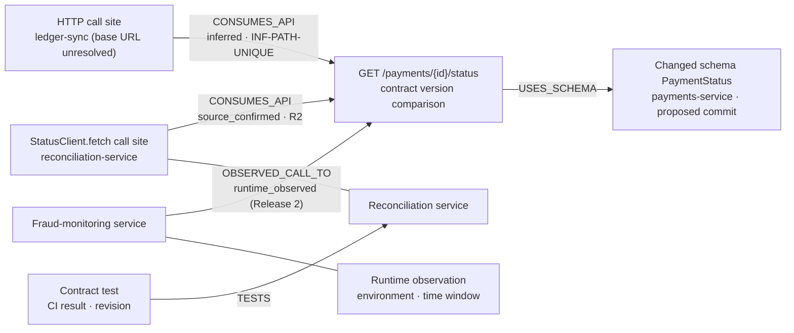
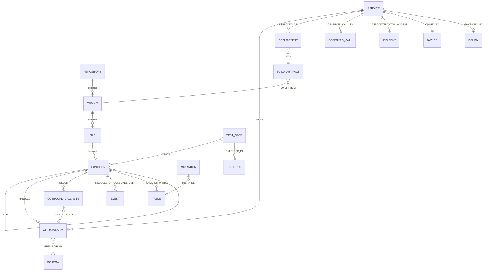
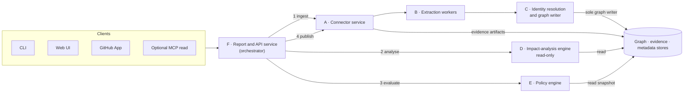
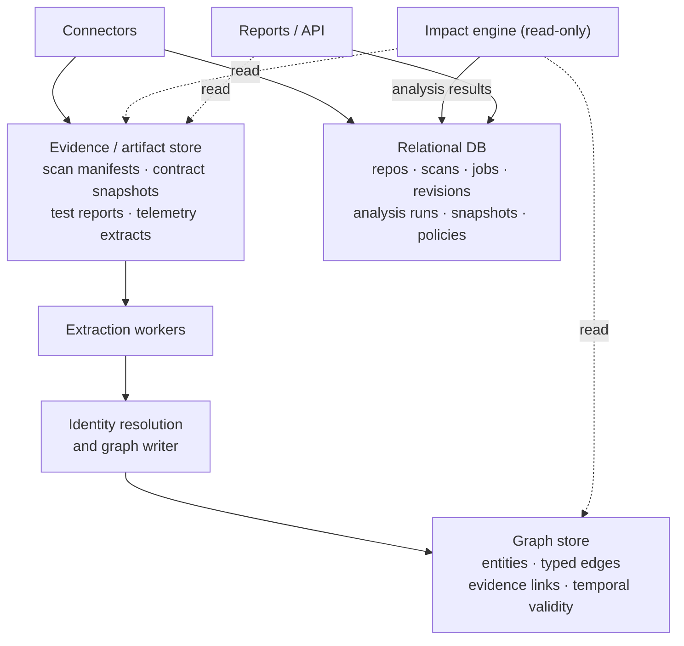
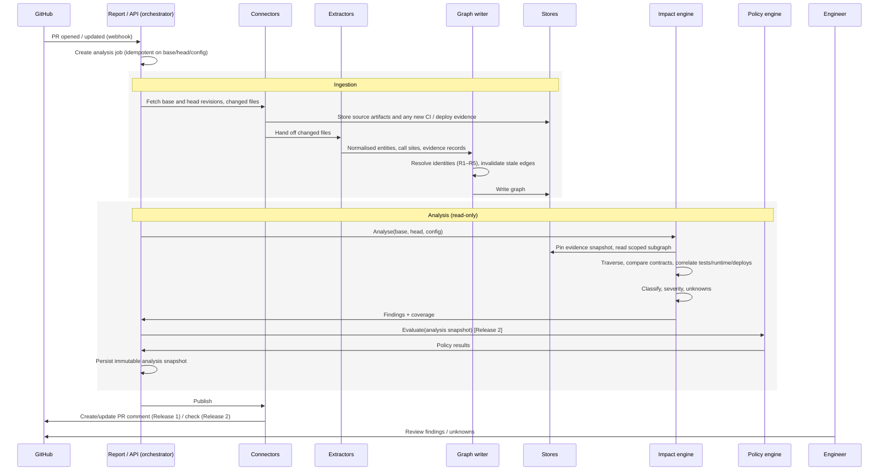
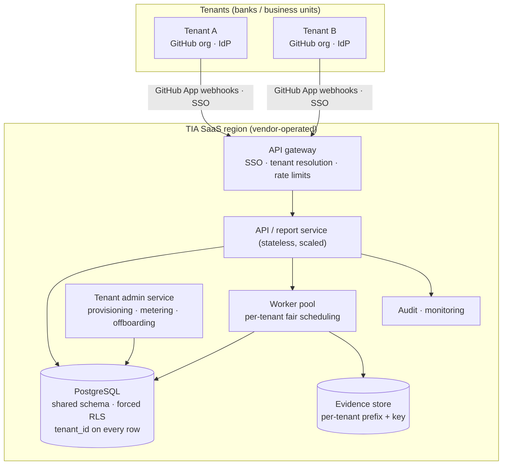
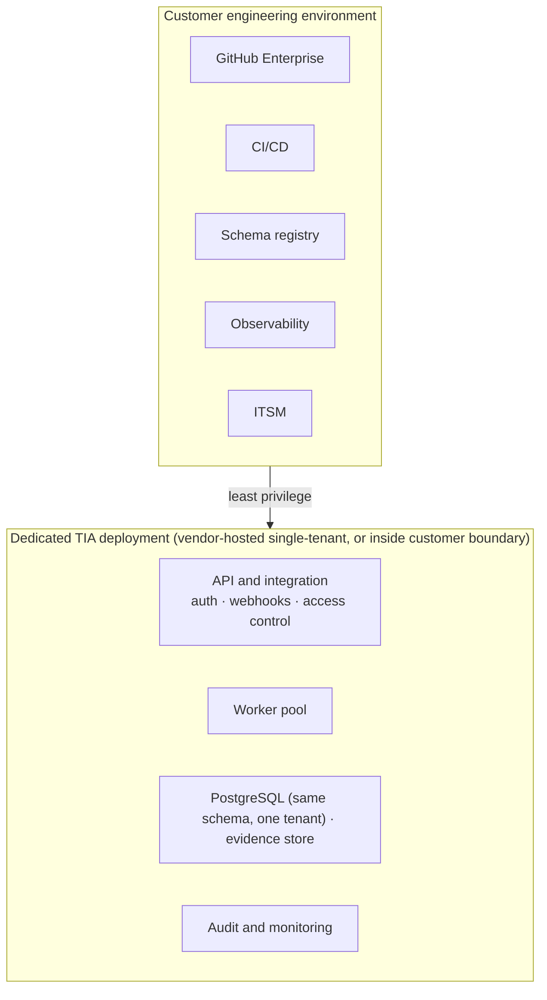
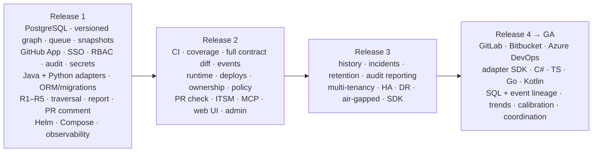
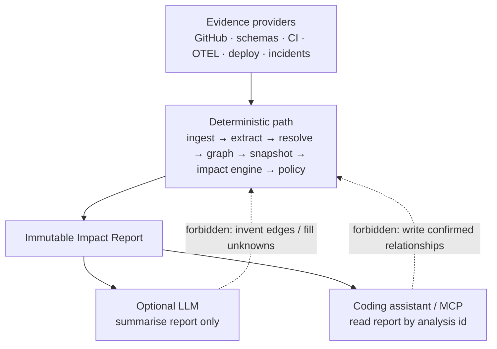

# TIA — Enterprise Change Impact Intelligence Architecture

| | |
|---|---|
| **Product** | TIA — Technical Impact Analysis |
| **Version** | 1.3 |
| **Document set** | PRD.md v3.1 · ARCHITECTURE.md v1.3 · TECHNICAL-FRAMEWORK.md v1.3 |
| **Status** | Proposed architecture |
| **Updated** | 2026-10-28 |

> **Precedence.** This document owns component boundaries and data flow. Entity names, relationship names, and status values are defined in TECHNICAL-FRAMEWORK.md §5 and §7; scope and phases in PRD.md §13.

## Design principles

The architecture is evidence-first, incremental, cross-repository, and version-aware. TIA sits above existing engineering tools, correlates their data, and calculates the impact of a proposed change without replacing GitHub, CI/CD, static analysis, or observability.

> **Locked architectural decision**
>
> Build one canonical, version-aware evidence graph with a deterministic impact engine above it. Connect existing tools as evidence providers. **Ingest first, then analyse:** connectors write evidence into TIA's stores; the impact engine reads only from those stores, pinned to an evidence snapshot. Keep release policy separate from impact discovery, and keep report generation separate from both.

That separation lets TIA evolve from a repository scanner into enterprise change intelligence without rebuilding the platform each time a new evidence source is added, and it is what makes every report reproducible.

### Layer separation (non-negotiable)

| Layer | Responsibility | Reads | Writes | Must not |
|---|---|---|---|---|
| Source ingestion (connectors) | Fetch authorised revisions & artifacts; publish PR comments/checks and ITSM attachments on request | External systems | Evidence store, metadata DB | Invent relationships |
| Evidence extraction | Emit normalised entities + evidence records with provenance | Evidence store | Hand-off to identity resolution only | Write graph edges |
| Identity resolution & graph writer | Cross-repo resolution (TFD §5.5), typed edges, stale invalidation | Extraction output, graph store | **Graph store (sole writer)** | Run release policy; create relationships outside TFD §5.4/§5.5 |
| Impact computation | Pin snapshot, base/head compare, traverse, classify, severity | Graph store, evidence store, metadata DB | Analysis results (metadata DB) | Call external systems; write the graph; invent missing consumers |
| Release-policy evaluation | `pass` / `fail` / `not_evaluated` / `requires_review` | Analysis snapshot, policies | Policy results | Auto-pass on missing evidence |
| Reporting | Immutable analysis snapshot → CLI / PR comment / UI / API / ITSM | Analysis + policy results | Report store | Mutate the graph |

An AI model may optionally summarise an existing report. It must never invent dependencies or write confirmed edges.

---

## 1. High-level architecture

```mermaid
flowchart TB
  subgraph sources["1 · Engineering systems"]
    GH["GitHub Enterprise"]
    SCH["API / event schemas"]
    CI["CI/CD"]
    COV["Coverage"]
    OTEL["OpenTelemetry"]
    DEP["Deployments"]
    INC["Incidents"]
    OWN["Ownership"]
    ITSM["ITSM change records"]
  end
  subgraph ingest["2 · Ingestion and evidence extraction"]
    RS["Repository scanner<br/>diffs · symbols · calls · endpoints<br/>outbound call sites · tests"]
    CS["Contract scanner<br/>API changes · schemas · compatibility"]
    CDA["CI / deployment adapters<br/>builds · test results · deployed versions"]
    ROA["Runtime / ops adapters<br/>observed calls · environments · incidents"]
  end
  subgraph norm["3 · Identity resolution and graph writer"]
    ID["Canonical IDs · service/repo mapping<br/>resolution strategies R1–R6 · inference rules<br/>provenance · evidence status · stale invalidation"]
  end
  subgraph tgraph["4 · Technical dependency graph"]
    CG["Code graph<br/>repo · commit · function · endpoint · call site"]
    CTG["Contract graph<br/>API · event · schema · consumer"]
    VG["Verification graph<br/>test · coverage · CI result"]
    RG["Runtime graph<br/>service · artifact · deploy · trace · incident"]
  end
  subgraph engine["5 · Change-impact engine (read-only)"]
    E0["0 Pin evidence snapshot"]
    E1["1 Compare base vs proposed"]
    E2["2 Resolve changed symbols / APIs / schemas"]
    E3["3 Traverse downstream dependencies"]
    E4["4 Correlate tests · runtime · deployments"]
    E5["5 Classify · severity · expose unknowns"]
  end
  subgraph out["6 · Policy and reporting"]
    IR["Impact report<br/>affected services · evidence paths · severity · unknowns"]
    PE["Release evaluation<br/>pass · fail · not evaluated · requires review"]
    SURF["CLI · PR comment / check · Web UI · API · ITSM attachment"]
  end
  sources -->|"read-only / least privilege"| ingest
  ingest --> norm
  norm --> tgraph
  tgraph --> engine
  engine --> IR
  IR --> PE
  IR --> SURF
  PE --> SURF
```

Normal flow is top → bottom. The design must also support incremental updates, evidence invalidation, re-analysis, and historical queries. No arrow runs from the impact engine back to the engineering systems: everything the engine needs is ingested first.

---

## 2. Graph model — what connects to what

The graph represents relationships needed for change-impact questions, not every extractable AST node. Relationship names below are the canonical names from TECHNICAL-FRAMEWORK.md §5.2.

### 2.1 Example: payment API changes

Impact engine output (illustrative):

| Finding | Evidence | Severity | Next check |
|---|---|---|---|
| Reconciliation | Source-confirmed consumer (R2); relevant contract test identified | High | Run contract tests |
| Ledger sync | Inferred consumer (unique path match; base URL unresolved) | Medium (inferred cap) | Confirm base URL / add to service map |
| Fraud monitoring (Release 2) | Runtime relationship observed; compatibility still needs verification | High | Verify against deployed consumer version |
| External consumers | Unknown — consumer inventory incomplete | Unknown | Connect missing repos / registries |

### 2.2 Entity and relationship groups

| Graph group | Important entities | Canonical relationships |
|---|---|---|
| Code | Repository, commit, file, function, outbound call site | `CONTAINS`, `CHANGED_IN`, `CALLS`, `ISSUES` |
| Interfaces | API endpoint, event, schema | `HANDLES`, `EXPOSES`, `CONSUMES_API`, `PRODUCES_EVENT`, `CONSUMES_EVENT`, `USES_SCHEMA` |
| Data | Data entity, table, migration | `READS`, `WRITES`, `MIGRATES` |
| Testing | Test case, test run, coverage record | `TESTS`, `EXECUTED_IN`, `COVERS` |
| Runtime | Service, build artifact, deployment, environment | `BUILT_FROM`, `DEPLOYED_AS`, `DEPLOYED_TO`, `OBSERVED_CALL_TO` |
| Operations | Incident, rollback, failure signature | `ASSOCIATED_WITH_INCIDENT` |
| Governance | Owner, criticality, policy, change record | `OWNED_BY`, `GOVERNED_BY` |

Every relationship needs evidence and a validity scope (revision and/or time window and/or environment). A consumer found at commit A must not be assumed for commit B or every production environment.

### 2.3 Logical ER sketch (impact-relevant)

---

## 3. Backend services and responsibilities

Logically separate; deployable as one service or as separate services; the HA topology (PRD PL-004) runs API and workers as independently scaled deployments.

| Service | Responsibility |
|---|---|
| A. Connector service | Retrieve authorised revisions, contracts, CI results, runtime evidence, deployments, incidents, change-record references; write them to the evidence store. Publish PR comments/checks and ITSM attachments when asked by F. Pagination, retries, permissions, incremental updates. |
| B. Extraction workers | Language parsers, framework adapters, outbound call-site extraction, schema diffing, test-report parsers. Emit normalised entities + evidence records — never graph writes. |
| C. Identity resolution & graph writer | Cross-repo identity, resolution strategies and inference rules (TFD §5.4–§5.5), dedupe, typed relationships, provenance, stale invalidation. Only component that writes the graph. |
| D. Impact-analysis engine | Pins an evidence snapshot; changed components, downstream traversal, contract diffs, relevant tests, deployment correlation, severity, structured findings. Read-only; never calls connectors. |
| E. Policy engine | Customer release rules vs an analysis snapshot. Missing evidence → `not_evaluated` / `requires_review`, never automatic pass. |
| F. Report and API service | Orchestrates jobs (ingest → analyse → evaluate → publish); serves reports, evidence paths, status, history, policy outcomes; applies per-user repository-permission filtering. |

---

## 4. Storage architecture

Separate logical stores for different access patterns. You do not need a different database product for every box.

| Store | Contents | Purpose |
|---|---|---|
| Graph store | Entities, typed edges, evidence links, temporal relationships | Dependency traversal and impact discovery |
| Relational DB | Repositories, scans, jobs, revisions, evidence snapshots, analysis runs, policies, status | Transactional metadata and workflow state |
| Evidence/artifact store | Scan manifests, contract snapshots, test reports, imported telemetry extracts, selected source evidence | Reproducibility and audit |

Runtime telemetry is **imported** into the evidence store by a connector (Release 2), not queried live by the engine.

- **Prototype:** SQLite + local evidence directory.
- **Release 1:** PostgreSQL for metadata *and* graph (versioned adjacency tables + recursive queries) + S3-compatible or controlled filesystem evidence store.
- **Enterprise:** PostgreSQL for workflow/metadata; dedicated graph store (RDF or property graph) only if the Release 2 benchmark shows PostgreSQL is insufficient. Avoid locking the architecture to proprietary graph features.

**Important:** Do not copy entire repositories, every trace, and every test log into the graph. Store compact relationships and stable references to detailed evidence.

---

## 5. End-to-end pull-request flow

### Processing rules

1. **Ingest, then analyse.** The impact engine never calls connectors or external systems. Anything not in the stores at snapshot time is reported as missing evidence.
2. **A new commit invalidates only affected evidence** — do not rebuild the entire enterprise graph unnecessarily.
3. **Identity resolution before impact traversal** — otherwise two references to the same service look unrelated.
4. **Traversal follows typed relationships** — `TESTS` ≠ `OBSERVED_CALL_TO` ≠ `CALLS` ≠ `CONSUMES_API`.
5. **The analysis result is a snapshot.** If the graph changes later, preserve the original report; create a new analysis when required.
6. **Only the newest revision updates the PR.** A completed analysis for a superseded head revision is stored but does not overwrite the PR comment/check.
7. **The GitHub surface reflects analysis status.** An incomplete analysis must not be reported as a clean impact assessment.
8. **Permission filtering at publish time.** Findings in repositories the PR's audience cannot read are shown only as a count.

---

## 6. Recommended technology stack

Practical starting point — not a mandate to adopt everything immediately. Canonical list: TECHNICAL-FRAMEWORK.md §3.

| Component | Starting point | Reason |
|---|---|---|
| GitHub integration | GitHub App + webhooks | Controlled permissions and PR lifecycle |
| API / backend | Python + FastAPI | Orchestration and integration APIs |
| Java analysis | Java parser + Spring adapters | Bank core services are predominantly Java |
| Python analysis | `ast` + framework adapters | Python services and data platforms |
| API contracts | OpenAPI parser + schema diff | Endpoints and compatibility |
| Event schemas (Release 2) | Format-specific adapters (JSON Schema, Avro) | Producer/consumer impact |
| Workflow metadata | PostgreSQL | Durable jobs, policies, concurrency |
| Graph storage | PostgreSQL first; RDF or property graph if benchmark requires | Typed traversal + evidence |
| Evidence storage | S3-compatible / customer-managed | Artifacts and audit |
| Background jobs | Postgres-backed queue first | Retryable incremental scans |
| UI (Release 2) | React | Reports and evidence-path explorer |
| Deployment | Containers, customer-controlled | Private / restricted environments |

Do not introduce Kafka, Kubernetes sprawl, multiple graph DBs, vector search, or an LLM agent framework "because enterprise." Add only when throughput, deployment, or retrieval requirements justify them.

---

## 7. API boundaries

CLI, UI, GitHub, and future clients share the same analysis engine. Canonical list: TECHNICAL-FRAMEWORK.md §8.

| Endpoint | Responsibility |
|---|---|
| `POST /api/v1/repositories` | Register an authorised repository |
| `POST /api/v1/scans` | Request a repository or revision scan |
| `GET /api/v1/scans/{scan_id}` | Scan status and coverage |
| `POST /api/v1/impact-analyses` | Start impact analysis for base/head |
| `GET /api/v1/impact-analyses/{analysis_id}` | Report and findings |
| `GET /api/v1/impact-analyses/{analysis_id}/paths` | Evidence paths for findings |
| `GET /api/v1/impact-analyses/{analysis_id}/unknowns` | Unknowns and unresolved call sites |
| `GET /api/v1/components/{component_id}/dependencies` | Scoped dependency information |
| `GET /api/v1/policies` | List configured release policies (Release 2) |
| `POST /api/v1/policy-evaluations` | Evaluate a report against policies (Release 2) |

All endpoints enforce authorisation and repository scope. Scans and impact analyses are asynchronous jobs, not blocking HTTP requests.

---

## 8. Deployment topology

### 8.1 Multi-tenant SaaS (primary)

Every request and job is bound to one tenant before it touches data; PostgreSQL row-level security enforces the boundary even if application code is wrong. Source is fetched transiently for extraction; only entities, relationships, and evidence references are stored.

### 8.2 Dedicated and customer-hosted (same code)

Customer-hosted deployments keep repository content and evidence inside the customer boundary. Outbound connections, telemetry retention, and any optional AI summarisation are explicitly controlled and off by default.

---

## 9. Build order

The build order follows the canonical releases in PRD §13. Every release is production quality; security is part of the foundation, not a final step.

| Release | Outcome |
|---|---|
| 1 | Secure, deployable platform producing cross-repository impact reports for Java and Python inside the pull request |
| 2 | Verification, contract, runtime, deployment, and policy evidence; PR check; change-record attachment; UI and administration |
| 3 | Historical and operational intelligence; enterprise scale, isolation, and resilience |
| 4 | Full platform and language coverage and advanced intelligence — General Availability |

---

## 10. Trust boundary (impact vs AI)

---

## Document history

| Version | Date | Notes |
|---|---|---|
| 1.0 | 2026-10-28 | Initial architecture from enterprise TIA design; Mermaid diagrams for HL view, graph example, services, storage, PR flow, deploy, build order, trust boundary |
| 1.1 | 2026-10-28 | Aligned with PRD v2.1 / TFD v1.1: ingest-then-analyse locked decision; layer table adds reads/writes; storage diagram no longer lets extraction write the graph directly; service diagram makes F the orchestrator and D read-only (removed engine → graph-writer and engine → connector calls); PR sequence split into ingestion and read-only analysis, policy evaluation invoked explicitly; canonical relationship names incl. `CONSUMES_API`, `HANDLES`, `ISSUES`; outbound call site entity; ITSM source and surface; PostgreSQL-first graph for Phase 1; build order replaced with PRD phases and security baseline moved into Phase 1 |
| 1.2 | 2026-10-29 | Aligned with PRD v3.0 enterprise scope: build order replaced by Releases 1–4; pilot/gate references removed; HA deployment note |
| 1.3 | 2026-10-29 | Deployment topology split into multi-tenant SaaS (primary; gateway, fair-scheduled workers, PostgreSQL with forced RLS, per-tenant evidence keys) and dedicated/customer-hosted (same code) |

*End of architecture*
