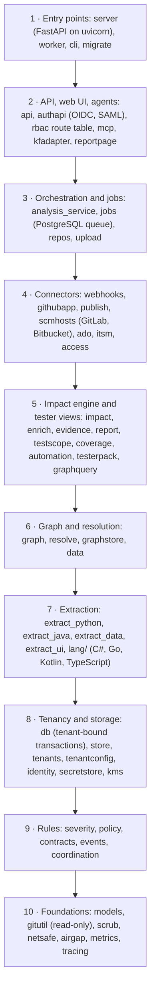

# TIA (Test Impact Analysis) Documentation

This folder contains the **Architecture Diagram** and **Interactive Codebase Mind Map** created to help you understand and navigate the TIA codebase rapidly.

---

## 📂 Documentation Files

| Document | Format | Description |
| :--- | :--- | :--- |
| [**Architecture as built**](ARCHITECTURE-AS-BUILT.md) ([HTML, open in a browser](ARCHITECTURE-AS-BUILT.html)) | Markdown & HTML (generated from the code) | The system as it is coded: the system picture, the 10 layers with every module in them, the layer rule (checked against the real imports on every test run), how work flows, every database table and its tenant isolation, deployment, and where the build differs from the design. |
| 🌐 [Interactive Architecture Diagram](architecture-diagram.html) · 🧠 [Codebase Mind Map](mind-map.html) | HTML (needs internet for Mermaid) | Early pictures from 30 Oct 2026, covering about 30 of today's 97 modules. Right as far as they go, but incomplete; use the as-built architecture above. |
| 📄 [**PRD (Product Requirements Document)**](PRD.md) ([PDF](PRD.pdf)) | Markdown & PDF | Complete product specification, user journeys, release phases, and acceptance criteria. |
| 🏛️ [**Architecture Specification**](ARCHITECTURE.md) ([PDF](ARCHITECTURE.pdf)) | Markdown & PDF | High-level system design, multi-tenant isolation, data flows, and component models. |
| ⚙️ [**Technical Framework**](TECHNICAL-FRAMEWORK.md) ([PDF](TECHNICAL-FRAMEWORK.pdf)) | Markdown & PDF | Technical implementation framework, algorithm specifications, and integration requirements. |
| [**Customer demo walkthrough**](DEMO-WALKTHROUGH.md) ([HTML, open in a browser](DEMO-WALKTHROUGH.html)) · [Demo data](DEMO-DATA.md) | Markdown & HTML | A 100-minute end-to-end technical demo: the code walkthrough layer by layer with real records, the UI script, agents and operations, and the hard questions. Demo data lists exact inputs and the numbers to expect. |
| [Administrator guide](ADMIN-GUIDE.md) · [User guide](USER-GUIDE.md) | Markdown | Installing, configuring and operating TIA; using its reports and views. |
| [API reference](API.md) · [OpenAPI](openapi.json) · [Python client](../sdk/python/tia_client/__init__.py) | Markdown, JSON | Every route with its permission (generated). |
| [Operations: HA, backup, DR](OPERATIONS.md) · [Compliance mapping](COMPLIANCE.md) · [Security](SECURITY.md) | Markdown | RPO/RTO runbook, SOC 2 / ISO 27001 control mapping, threat model. |
| [Language adapter SDK](ADAPTER-SDK.md) · [Graph store decision](GRAPH-STORE.md) · [Performance](PERFORMANCE.md) · [Release gates](RELEASE-GATES.md) | Markdown | Adding languages; why PostgreSQL holds the graph; benchmark results; gate assessment. |

> **Tip:** double-click any `.html` file in Windows Explorer, or open it in any browser. The as-built architecture and the demo walkthrough work offline.

---

## 🏛️ High-Level System Architecture

The full picture, with every module, is [ARCHITECTURE-AS-BUILT](ARCHITECTURE-AS-BUILT.html). In short: ten layers, and a module may use only its own layer or the ones below it.

---

## ⚡ How It Works: End-to-End Pipeline

1. **Request:** a person (web UI or REST), a pull-request webhook (`webhooks.py`, `githubapp.py`, `scmhosts.py`, `ado.py`) or the CLI (`cli.py`) asks for an analysis. `authapi.py` checks the caller against the `rbac.py` route table (an unlisted route is refused) and binds the work to one tenant; webhooks are queued (`jobs.py`) and run by `worker.py`.
2. **Resolve:** `analysis_service.py` turns branch names into exact commits (`gitutil.py`, read-only git) and caps the limits with the tenant's configuration (`tenantconfig.py`).
3. **Extraction:** `extraction.py` parses only files whose git blob it has not seen: `extract_python.py` (`ast`), `extract_java.py` and `lang/` (tree-sitter), `extract_data.py` and `extract_orm.py` (tables and migrations), `extract_ui.py` (pages and elements). Code is read as bytes; it is never imported or run.
4. **Graph:** `graph.py` and `resolve.py` connect the facts across repositories into one typed graph; every edge carries how it was resolved and its evidence. `graphstore.py` records the version.
5. **Impact:** `impact.py` diffs contracts, data and functions, walks the graph within explicit bounds, adds ingested CI, coverage, deployment and runtime evidence (`enrich.py`), and scores each finding with the fixed rule table in `severity.py` (no AI). `policy.py` evaluates release rules.
6. **Report:** `report.py` renders it with the tester views (`testscope.py`, `coverage.py`, `automation.py`, `testerpack.py`); `store.py` saves it with an evidence snapshot id and an audit hash-chain entry; `publish.py` updates the PR comment and check run. The same inputs always give the same report (`POST .../reproduce` proves it).
