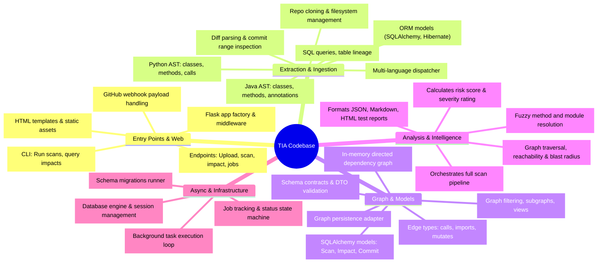

# TIA (Test Impact Analysis) Documentation

This folder contains the **Architecture Diagram** and **Interactive Codebase Mind Map** created to help you understand and navigate the TIA codebase rapidly.

---

## 📂 Documentation Files

| Document | Format | Description |
| :--- | :--- | :--- |
| 🌐 [**Interactive Architecture Diagram**](architecture-diagram.html) | HTML (Mermaid.js + Interactive Controls) | Layer-by-layer breakdown: API, Services, AST Extractors, Graph Store, Analysis & Impact Engine, Database & Webhooks. |
| 🧠 [**Interactive Codebase Mind Map**](mind-map.html) | HTML (Interactive Tabs & Module Cards) | Conceptual mind map covering core domains, lifecycle pipelines, data models, and module reference cards. |
| 📄 [**PRD (Product Requirements Document)**](PRD.md) ([PDF](PRD.pdf)) | Markdown & PDF | Complete product specification, user journeys, release phases, and acceptance criteria. |
| 🏛️ [**Architecture Specification**](ARCHITECTURE.md) ([PDF](ARCHITECTURE.pdf)) | Markdown & PDF | High-level system design, multi-tenant isolation, data flows, and component models. |
| ⚙️ [**Technical Framework**](TECHNICAL-FRAMEWORK.md) ([PDF](TECHNICAL-FRAMEWORK.pdf)) | Markdown & PDF | Technical implementation framework, algorithm specifications, and integration requirements. |

> **Tip:** You can double-click either `.html` file in Windows Explorer or open them in any browser (Chrome, Edge, etc.) for full pan/zoom, interactive filtering, and styled Mermaid visualisations.

---

## 🏛️ High-Level System Architecture

```mermaid
flowchart TB
    subgraph Clients["Entry Points & Clients"]
        CLI["CLI Tool (cli.py)"]
        WEB["Web UI & Dashboard (web/)"]
        CI["CI/CD & GitHub Webhooks (webhooks.py, github.py)"]
    end

    subgraph API["HTTP & Routing Layer"]
        SRV["Flask Server (server.py)"]
        ROUTES["REST API Routes (api.py)"]
        UP["File Uploads / Repos (upload.py, repos.py)"]
    end

    subgraph Core["Core Business Services"]
        SVC["Analysis Service (analysis_service.py)"]
        IMP["Impact Analysis Engine (impact.py)"]
        SEV["Severity Engine (severity.py)"]
        REP["Report Generator (report.py)"]
        JOB["Job Queue / Workers (jobs.py, worker.py)"]
    end

    subgraph Extractors["AST & Schema Extraction"]
        EX_PY["Python AST Extractor (extract_python.py)"]
        EX_JAVA["Java Parser (extract_java.py)"]
        EX_DATA["Data/SQL Extractor (extract_data.py)"]
        EX_ORM["ORM Mapping Extractor (extract_orm.py)"]
        EX_BASE["Extraction Pipeline (extraction.py)"]
        GIT["Git Diffs & Blame (gitutil.py)"]
    end

    subgraph Storage["Data, Graph & Persistence Layer"]
        GRAPH["Code Dependency Graph (graph.py, graphview.py)"]
        GSTORE["Graph Store (graphstore.py, store.py)"]
        DB["Relational Database & Models (db.py, models.py, migrate.py)"]
        CONTRACTS["Data Contracts & Types (contracts.py, data.py, relationships.py)"]
    end

    Clients --> API
    API --> Core
    Core --> Extractors
    Core --> Storage
    Extractors --> Storage
```

---

## 🧠 Codebase Mind Map (Quick Reference)

---

## ⚡ How It Works: End-to-End Pipeline

1. **Ingestion & Git Diff:** A commit or PR arrives via `webhooks.py` or the CLI (`cli.py`). `gitutil.py` inspects the diff to determine modified files, lines, and methods.
2. **Extraction:** Specialized extractors (`extract_python.py`, `extract_java.py`, `extract_data.py`, `extract_orm.py`) parse the codebases into unified nodes (classes, functions, endpoints, tables, queries) and edges (calls, imports, reads, writes).
3. **Graph Construction:** `graph.py` and `relationships.py` link callers, callees, data tables, and test cases into a queryable dependency graph.
4. **Impact Analysis:** `impact.py` performs reverse reachability traversals starting from changed nodes to identify all affected tests, APIs, and downstream consumers.
5. **Severity & Scoring:** `severity.py` calculates risk metrics based on change magnitude, critical paths, and test coverage.
6. **Reporting & Feedback:** `report.py` emits targeted test sets to run in CI, saving test execution time.
